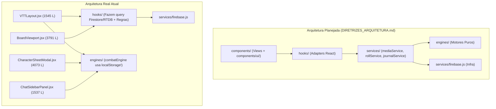
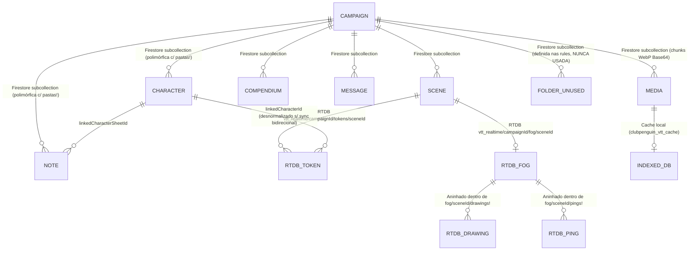
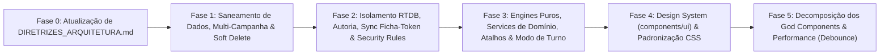

# Auditoria Técnica de Arquitetura de Software, Engenharia de Dados e Qualidade de Código — ClubPenguinVTT

> [!IMPORTANT]
> Este diagnóstico foi elaborado após a inspeção integral dos **37 arquivos de código-fonte e configuração** (~25.500 linhas de código) do repositório, confrontando a implementação atual com o documento [DIRETRIZES_ARQUITETURA.md](file:///c:/Users/erick/OneDrive%20-%20e-Digital%20Fullcommerce/.Downloads/erick%20-%20pessoal/BibliotecaKotlin/ClubPenguinVTT/DIRETRIZES_ARQUITETURA.md) e com boas práticas de Engenharia de Software (SOLID, Clean Architecture, DRY), Engenharia de Dados (modelagem NoSQL híbrida Firestore + RTDB + IndexedDB) e Segurança. **Nenhum arquivo do projeto foi modificado.**

---

## 1. Diagnóstico Executivo e Métricas do Código

O projeto possui funcionalidades ricas e estética autêntica, mas sofre do sintoma clássico de **crescimento orgânico acelerado sem refatoração contínua**: novas mecânicas (AoE, testes de resistência automáticos, bolas de neve na hotbar, janela destacada `?sheetId=`, pastas de fichas e notas, desenhos vetoriais no mapa) foram empilhadas diretamente dentro dos componentes visuais e hooks existentes.

### Concentração de Complexidade (Top 10 Maiores Arquivos)

| Arquivo | Linhas | Responsabilidade Atual | Diagnóstico |
| :--- | :---: | :--- | :--- |
| [CharacterSheetModal.jsx](file:///c:/Users/erick/OneDrive%20-%20e-Digital%20Fullcommerce/.Downloads/erick%20-%20pessoal/BibliotecaKotlin/ClubPenguinVTT/src/components/sheets/CharacterSheetModal.jsx) | **4.073** | Ficha completa, 5 abas, 38 `useState`, 4 subcomponentes, CRUD de itens/perícias/magias/grupos, modais de ícone e hotbar | **God Component Crítico** |
| [BoardViewport.jsx](file:///c:/Users/erick/OneDrive%20-%20e-Digital%20Fullcommerce/.Downloads/erick%20-%20pessoal/BibliotecaKotlin/ClubPenguinVTT/src/components/canvas/BoardViewport.jsx) | **3.791** | Câmera Pan/Zoom, grid, SVG de rabiscos/formas, editor de texto inline, seleção/rotação matemática, régua/AoE, projéteis de bola de neve, atalhos e barra de ferramentas | **God Component Crítico** |
| [NoteEditorModal.jsx](file:///c:/Users/erick/OneDrive%20-%20e-Digital%20Fullcommerce/.Downloads/erick%20-%20pessoal/BibliotecaKotlin/ClubPenguinVTT/src/components/journal/NoteEditorModal.jsx) | **1.588** | Editor em blocos, parser de markdown `##`, motor interativo de aliases com portal popover, clonagem e controle de acesso | **God Component** |
| [VTTLayout.jsx](file:///c:/Users/erick/OneDrive%20-%20e-Digital%20Fullcommerce/.Downloads/erick%20-%20pessoal/BibliotecaKotlin/ClubPenguinVTT/src/components/layout/VTTLayout.jsx) | **1.545** | Orquestrador global de estado, todos os hooks do Firebase, pipeline de dano/cura/resistência, dock de chat, janela standalone | **God Orchestrator** |
| [ChatSidebarPanel.jsx](file:///c:/Users/erick/OneDrive%20-%20e-Digital%20Fullcommerce/.Downloads/erick%20-%20pessoal/BibliotecaKotlin/ClubPenguinVTT/src/components/chat/ChatSidebarPanel.jsx) | **1.537** | Chat, rolador rápido, seletor de identidade, cards de ataque/dano/resistência e calculadora de aplicação de efeito do Mestre | **God Component** |
| [JournalWorkspace.jsx](file:///c:/Users/erick/OneDrive%20-%20e-Digital%20Fullcommerce/.Downloads/erick%20-%20pessoal/BibliotecaKotlin/ClubPenguinVTT/src/components/journal/JournalWorkspace.jsx) | **1.426** | Árvore recursiva de pastas por caminho, drag-and-drop, filtros de escopo e container do grafo | **Acoplamento Alto** |
| [LoginScreen.jsx](file:///c:/Users/erick/OneDrive%20-%20e-Digital%20Fullcommerce/.Downloads/erick%20-%20pessoal/BibliotecaKotlin/ClubPenguinVTT/src/components/auth/LoginScreen.jsx) | **1.360** | Telas de Login, Cadastro com upload de foto e Recuperação de Senha em um único arquivo com 100% de inline styles | **Monolito Visual** |
| [App.css](file:///c:/Users/erick/OneDrive%20-%20e-Digital%20Fullcommerce/.Downloads/erick%20-%20pessoal/BibliotecaKotlin/ClubPenguinVTT/src/App.css) | **1.355** | Estilos globais de janelas, botões, layout, player card e inventário | **Folha Única Global** |
| [CharactersSidebarList.jsx](file:///c:/Users/erick/OneDrive%20-%20e-Digital%20Fullcommerce/.Downloads/erick%20-%20pessoal/BibliotecaKotlin/ClubPenguinVTT/src/components/sheets/CharactersSidebarList.jsx) | **1.206** | Lista de fichas, árvore recursiva de pastas por ID, 3 modais embutidos | **Múltiplas Responsabilidades** |
| [ScenesManagerModal.jsx](file:///c:/Users/erick/OneDrive%20-%20e-Digital%20Fullcommerce/.Downloads/erick%20-%20pessoal/BibliotecaKotlin/ClubPenguinVTT/src/components/scenes/ScenesManagerModal.jsx) | **813** | CRUD de cenas, configuração de grade, upload de fundo e áudio ambiente | **Moderado / Alto** |

> **Apenas os 7 maiores componentes concentram ~15.320 linhas (mais de 60% de todo o projeto).**

---

## 2. Estrutura de Pastas e Arquitetura de Software

### 2.1. Arquitetura Planejada vs. Arquitetura Real

Na seção 6 de [DIRETRIZES_ARQUITETURA.md](file:///c:/Users/erick/OneDrive%20-%20e-Digital%20Fullcommerce/.Downloads/erick%20-%20pessoal/BibliotecaKotlin/ClubPenguinVTT/DIRETRIZES_ARQUITETURA.md#L569-L639), foi definida uma arquitetura em camadas clara, porém desvios estruturais ocorreram durante a implementação:

1. **Ausência da pasta `src/components/ui/`**:
   - Prevista nas diretrizes (`WindowModal.jsx`, `CPButton.jsx`, `EPFBadge.jsx`), nunca foi criada.
   - Como consequência, modais (`position: fixed, inset: 0, backdropFilter...`), cabeçalhos de janela, botões de fechar, seletores de ícone e badges são recriados dezenas de vezes manualmente via `style={{ ... }}`.
2. **Ausência de Serviços de Domínio (`rollService.js`, `journalService.js`, `combatService.js`, `characterService.js`)**:
   - Apenas [firebase.js](file:///c:/Users/erick/OneDrive%20-%20e-Digital%20Fullcommerce/.Downloads/erick%20-%20pessoal/BibliotecaKotlin/ClubPenguinVTT/src/services/firebase.js) e [mediaService.js](file:///c:/Users/erick/OneDrive%20-%20e-Digital%20Fullcommerce/.Downloads/erick%20-%20pessoal/BibliotecaKotlin/ClubPenguinVTT/src/services/mediaService.js) existem em `src/services/`.
   - Os hooks em `src/hooks/` acumulam **três responsabilidades simultâneas**: (a) gerenciamento de estado React (`useState`/`useEffect`), (b) acesso direto ao SDK do Firebase (`onSnapshot`, `addDoc`, `updateDoc`, `onValue`), e (c) regras de negócio, filtragem de segurança e migrações de dados.
3. **Contaminação da Camada `src/engines/`**:
   - Os motores em `src/engines/` deveriam ser funções puras e agnósticas de ambiente (testáveis em Node puro sem DOM).
   - No entanto, [combatEngine.js](file:///c:/Users/erick/OneDrive%20-%20e-Digital%20Fullcommerce/.Downloads/erick%20-%20pessoal/BibliotecaKotlin/ClubPenguinVTT/src/engines/combatEngine.js#L99-L147) acessa diretamente `localStorage.getItem` e `localStorage.setItem` para sincronizar alvos entre abas do navegador.
4. **Ausência de Roteamento ou Separação de Entrypoint para Janela Destacada (`?sheetId=`)**:
   - Em [VTTLayout.jsx](file:///c:/Users/erick/OneDrive%20-%20e-Digital%20Fullcommerce/.Downloads/erick%20-%20pessoal/BibliotecaKotlin/ClubPenguinVTT/src/components/layout/VTTLayout.jsx#L70-L120), mesmo quando a janela é aberta em modo pop-out (`?sheetId=...`), o componente monta **todas** as assinaturas em tempo real do Firebase (`useScenes`, `useCharacters`, `useChatRolls`, `useCompendium`, `useJournalNotes`, além da presença no RTDB) antes de fazer um `return` antecipado na linha [805](file:///c:/Users/erick/OneDrive%20-%20e-Digital%20Fullcommerce/.Downloads/erick%20-%20pessoal/BibliotecaKotlin/ClubPenguinVTT/src/components/layout/VTTLayout.jsx#L805-L840).
   - **Bug funcional decorrente disso**: Como o `return` antecipado do modo `standaloneSheetId` ocorre na linha 805 e os modais [DamageRollModal](file:///c:/Users/erick/OneDrive%20-%20e-Digital%20Fullcommerce/.Downloads/erick%20-%20pessoal/BibliotecaKotlin/ClubPenguinVTT/src/components/layout/VTTLayout.jsx#L1486-L1501) e [SavingThrowModal](file:///c:/Users/erick/OneDrive%20-%20e-Digital%20Fullcommerce/.Downloads/erick%20-%20pessoal/BibliotecaKotlin/ClubPenguinVTT/src/components/layout/VTTLayout.jsx#L1504-L1519) só são renderizados no final do arquivo, **qualquer rolagem de dano ou teste de resistência acionada na janela destacada abre o estado `damageModalContext`, mas o modal nunca aparece na tela!**

---

## 3. Engenharia de Dados, Modelagem e Arquitetura do Banco

### 3.1. Diagrama Entidade-Relacionamento Atual (Híbrido Firestore + RTDB + IndexedDB)

### 3.2. Falhas Críticas de Segurança no Banco (`firestore.rules` e `database.rules.json`)

> [!CAUTION]
> **As regras atuais de segurança permitem leitura irrestrita de segredos do Mestre e escrita irrestrita por qualquer usuário autenticado.**

1. **Função `canSeeResource` Criada mas Nunca Utilizada ([firestore.rules](file:///c:/Users/erick/OneDrive%20-%20e-Digital%20Fullcommerce/.Downloads/erick%20-%20pessoal/BibliotecaKotlin/ClubPenguinVTT/firestore.rules#L15-L22))**:
   - A função `canSeeResource(campaignId, resourceData)` está implementada nas linhas 15–22, mas **não é chamada em nenhuma regra do arquivo**.
   - Nas coleções `characters` (linha 44), `compendium` (linha 51), `messages` (linha 58) e `notes` (linha 73), a regra é simplesmente `allow read: if isSignedIn();`.
   - **Impacto**: Todo o sistema "anti-spoiler" do Diário (`scope === "gm"`), NPCs ocultos do Mestre e rolagens secretas (`visibility === "gm_only"`) é filtrado **apenas no JavaScript do navegador** ([useCharacters.js](file:///c:/Users/erick/OneDrive%20-%20e-Digital%20Fullcommerce/.Downloads/erick%20-%20pessoal/BibliotecaKotlin/ClubPenguinVTT/src/hooks/useCharacters.js#L85-L94), [useChatRolls.js](file:///c:/Users/erick/OneDrive%20-%20e-Digital%20Fullcommerce/.Downloads/erick%20-%20pessoal/BibliotecaKotlin/ClubPenguinVTT/src/hooks/useChatRolls.js#L48-L60), [useJournalNotes.js](file:///c:/Users/erick/OneDrive%20-%20e-Digital%20Fullcommerce/.Downloads/erick%20-%20pessoal/BibliotecaKotlin/ClubPenguinVTT/src/hooks/useJournalNotes.js#L62-L81)). O Firebase envia 100% dos documentos secretos do Mestre pela rede para os computadores de todos os jogadores (visíveis na aba Network/ DevTools) e cobra leitura de documento por todos eles.
2. **Tautologia Lógica na Regra de Campanha ([firestore.rules](file:///c:/Users/erick/OneDrive%20-%20e-Digital%20Fullcommerce/.Downloads/erick%20-%20pessoal/BibliotecaKotlin/ClubPenguinVTT/firestore.rules#L27))**:
   - `allow update: if isGM(campaignId) || isSignedIn();` — como `isGM` já exige `isSignedIn()`, a expressão `A || B` onde `A -> B` reduz-se a `isSignedIn()`. Qualquer jogador logado pode sobrescrever `gmId`, `authorizedEmails` ou `activeSceneId`.
3. **Realtime Database Totalmente Aberto ([database.rules.json](file:///c:/Users/erick/OneDrive%20-%20e-Digital%20Fullcommerce/.Downloads/erick%20-%20pessoal/BibliotecaKotlin/ClubPenguinVTT/database.rules.json#L1-L24))**:
   - `tokens/$sceneId` e `fog/$sceneId` possuem `.write: "auth != null"`. Qualquer jogador pode apagar a Névoa de Guerra inteira ou deletar tokens do Mestre.

### 3.3. Problemas de Modelagem, Relacionamento e Integridade Referencial

1. **Polimorfismo Improvisado de Pastas (`isFolder: true`) e Dois Modelos Incompatíveis**:
   - Embora [firestore.rules](file:///c:/Users/erick/OneDrive%20-%20e-Digital%20Fullcommerce/.Downloads/erick%20-%20pessoal/BibliotecaKotlin/ClubPenguinVTT/firestore.rules#L80-L91) tenha uma subcoleção dedicada `campaigns/{campaignId}/folders/{folderId}`, ela **não é usada em lugar nenhum**.
   - Em [useCharacters.js](file:///c:/Users/erick/OneDrive%20-%20e-Digital%20Fullcommerce/.Downloads/erick%20-%20pessoal/BibliotecaKotlin/ClubPenguinVTT/src/hooks/useCharacters.js#L254-L270), pastas são salvas como documentos dentro da coleção `characters` com `isFolder: true` e relacionam-se por ID (`folder.parentId` e `character.folderId`).
   - Em [useJournalNotes.js](file:///c:/Users/erick/OneDrive%20-%20e-Digital%20Fullcommerce/.Downloads/erick%20-%20pessoal/BibliotecaKotlin/ClubPenguinVTT/src/hooks/useJournalNotes.js#L361-L382), pastas são salvas dentro da coleção `notes` com `isFolder: true`, mas relacionam-se por **strings de caminho separadas por barra** (`note.folder = "Ato 1/Subpasta"` e `folder.name = "Ato 1/Subpasta"`).
   - **Bug de integridade em [useJournalNotes.js](file:///c:/Users/erick/OneDrive%20-%20e-Digital%20Fullcommerce/.Downloads/erick%20-%20pessoal/BibliotecaKotlin/ClubPenguinVTT/src/hooks/useJournalNotes.js#L387-L413)**: Ao excluir uma pasta pai (`"Ato 1"`), `deleteFolder` compara apenas igualdade exata (`n.folder === folderName`) e não atualiza notas nem subpastas filhas (`"Ato 1/Subpasta"`), além de executar `await updateDoc` dentro de um `for...of` sequencial em vez de usar `writeBatch`.
2. **Dessincronização Bidirecional entre `tokens` (RTDB) e `characters` (Firestore)**:
   - Quando um token é colocado no mapa ([VTTLayout.jsx](file:///c:/Users/erick/OneDrive%20-%20e-Digital%20Fullcommerce/.Downloads/erick%20-%20pessoal/BibliotecaKotlin/ClubPenguinVTT/src/components/layout/VTTLayout.jsx#L668-L702)), `hpCurrent`, `hpMax`, `defense`, `name`, `mediaId` e `ringColor` são copiados para o nó do token no RTDB.
   - Se o jogador/Mestre altera HP, Defesa, Nome ou Foto na ficha ([CharacterSheetModal.jsx](file:///c:/Users/erick/OneDrive%20-%20e-Digital%20Fullcommerce/.Downloads/erick%20-%20pessoal/BibliotecaKotlin/ClubPenguinVTT/src/components/sheets/CharacterSheetModal.jsx#L409-L422)), **o token no mapa não é atualizado**.
   - Se o Mestre ajusta o HP diretamente no popup rápido do token no mapa (`handleQuickAdjustHp` em [BoardViewport.jsx](file:///c:/Users/erick/OneDrive%20-%20e-Digital%20Fullcommerce/.Downloads/erick%20-%20pessoal/BibliotecaKotlin/ClubPenguinVTT/src/components/canvas/BoardViewport.jsx#L1350-L1358)), **a ficha do personagem no Firestore não é atualizada**.
   - Apenas `handleApplyCombatEffect` ([VTTLayout.jsx](file:///c:/Users/erick/OneDrive%20-%20e-Digital%20Fullcommerce/.Downloads/erick%20-%20pessoal/BibliotecaKotlin/ClubPenguinVTT/src/components/layout/VTTLayout.jsx#L569-L639)) atualiza ambos.
3. **Desnormalização por Cópia de Valor em `rollGroups` e `hotbar`**:
   - Em [CharacterSheetModal.jsx](file:///c:/Users/erick/OneDrive%20-%20e-Digital%20Fullcommerce/.Downloads/erick%20-%20pessoal/BibliotecaKotlin/ClubPenguinVTT/src/components/sheets/CharacterSheetModal.jsx#L482-L513) (`pinToRollGroup`) e [linhas 891–913](file:///c:/Users/erick/OneDrive%20-%20e-Digital%20Fullcommerce/.Downloads/erick%20-%20pessoal/BibliotecaKotlin/ClubPenguinVTT/src/components/sheets/CharacterSheetModal.jsx#L891-L913) (`handleAssignRollToHotbar`), fixar uma Habilidade/Perícia/Item copia todos os campos (`hitFormula`, `effectFormula`, `costAmount`, `savingThrow`) para dentro de `rollGroups` e depois copia novamente para `hotbar`.
   - Se o jogador editar a fórmula ou o custo da Habilidade na aba Skills, a rolagem fixada na aba Rolagens e na Hotbar de Bolas de Neve continua usando a fórmula antiga.
4. **Vazamento de Dados Órfãos (Orphaned Data Leaks)**:
   - **Notas excluídas não apagam imagem**: [useJournalNotes.js](file:///c:/Users/erick/OneDrive%20-%20e-Digital%20Fullcommerce/.Downloads/erick%20-%20pessoal/BibliotecaKotlin/ClubPenguinVTT/src/hooks/useJournalNotes.js#L338-L355) (`deleteNote`) deleta o documento em `notes/{id}`, mas nunca chama `deleteMedia(campaignId, existing.imageMediaId)`.
   - **Tokens excluídos ou com imagem trocada não apagam mídia customizada**: [useRealtimeTokens.js](file:///c:/Users/erick/OneDrive%20-%20e-Digital%20Fullcommerce/.Downloads/erick%20-%20pessoal/BibliotecaKotlin/ClubPenguinVTT/src/hooks/useRealtimeTokens.js#L168-L194) (`updateToken`, `removeToken`) nunca remove mídias avulsas criadas em [TokenModal.jsx](file:///c:/Users/erick/OneDrive%20-%20e-Digital%20Fullcommerce/.Downloads/erick%20-%20pessoal/BibliotecaKotlin/ClubPenguinVTT/src/components/canvas/TokenModal.jsx#L85-L94).
   - **Cenas excluídas deixam lixo no RTDB**: [useScenes.js](file:///c:/Users/erick/OneDrive%20-%20e-Digital%20Fullcommerce/.Downloads/erick%20-%20pessoal/BibliotecaKotlin/ClubPenguinVTT/src/hooks/useScenes.js#L202-L217) (`deleteScene`) apaga a cena no Firestore e suas mídias, mas nunca remove `vtt_realtime/{campaignId}/tokens/{sceneId}` nem `vtt_realtime/{campaignId}/fog/{sceneId}` no Realtime Database.
5. **Duplicação de Conteúdo em Notas (`content` + `sections`)**:
   - Em [NoteEditorModal.jsx](file:///c:/Users/erick/OneDrive%20-%20e-Digital%20Fullcommerce/.Downloads/erick%20-%20pessoal/BibliotecaKotlin/ClubPenguinVTT/src/components/journal/NoteEditorModal.jsx#L501-L525) e [useJournalNotes.jsx](file:///c:/Users/erick/OneDrive%20-%20e-Digital%20Fullcommerce/.Downloads/erick%20-%20pessoal/BibliotecaKotlin/ClubPenguinVTT/src/hooks/useJournalNotes.js#L163-L164), todo card salva o array `sections` e também a string `content` concatenada com o mesmo texto, dobrando o consumo de bytes por documento.
6. **Tempestade de Escritas no Firestore (Ausência de Debounce)**:
   - Em [CharacterSheetModal.jsx](file:///c:/Users/erick/OneDrive%20-%20e-Digital%20Fullcommerce/.Downloads/erick%20-%20pessoal/BibliotecaKotlin/ClubPenguinVTT/src/components/sheets/CharacterSheetModal.jsx#L1018-L1024) (`name`), [linhas 2015–2196](file:///c:/Users/erick/OneDrive%20-%20e-Digital%20Fullcommerce/.Downloads/erick%20-%20pessoal/BibliotecaKotlin/ClubPenguinVTT/src/components/sheets/CharacterSheetModal.jsx#L2015-L2196) (`hp`, `mp`, `defense`, `level`), [linha 2362](file:///c:/Users/erick/OneDrive%20-%20e-Digital%20Fullcommerce/.Downloads/erick%20-%20pessoal/BibliotecaKotlin/ClubPenguinVTT/src/components/sheets/CharacterSheetModal.jsx#L2362) (`attr.value`) e principalmente nas `<textarea>` de `biography` e `notes` ([linhas 3347 e 3362](file:///c:/Users/erick/OneDrive%20-%20e-Digital%20Fullcommerce/.Downloads/erick%20-%20pessoal/BibliotecaKotlin/ClubPenguinVTT/src/components/sheets/CharacterSheetModal.jsx#L3341-L3366)), cada tecla pressionada (`onChange`) dispara imediatamente um `updateDoc` no Firestore! Digitar um parágrafo de 200 caracteres gera 200 operações de escrita no banco e 200 snapshots enviados a todos os jogadores online, além de causar perda de cursor na `<textarea>`.
7. **Ausência de Marcação Explícita de `campaignId` nos Payloads, URLs e Cache (Preparação Multi-Campanha Incompleta)**:
   - Embora os caminhos do Firestore (`campaigns/{campaignId}/...`) e do RTDB (`vtt_realtime/{campaignId}/...`) usem `campaignId`, **nenhum documento criado** em `characters`, `folders`, `scenes`, `notes`, `messages`, `compendium`, `media`, `tokens`, `drawings` ou `fog` grava a propriedade `campaignId` dentro do próprio objeto JSON! Isso inviabiliza consultas `collectionGroup`, auditorias, exportação/clonagem entre campanhas e migrações futuras.
   - Nas janelas destacadas (`?sheetId=...` em [CharacterSheetModal.jsx](file:///c:/Users/erick/OneDrive%20-%20e-Digital%20Fullcommerce/.Downloads/erick%20-%20pessoal/BibliotecaKotlin/ClubPenguinVTT/src/components/sheets/CharacterSheetModal.jsx#L401) e [CharactersSidebarList.jsx](file:///c:/Users/erick/OneDrive%20-%20e-Digital%20Fullcommerce/.Downloads/erick%20-%20pessoal/BibliotecaKotlin/ClubPenguinVTT/src/components/sheets/CharactersSidebarList.jsx#L25)), a URL não inclui `campaignId` (`?campaignId=...&sheetId=...`), assumindo sempre a campanha hardcoded `"main-table"`.
   - No cache local IndexedDB ([mediaService.js](file:///c:/Users/erick/OneDrive%20-%20e-Digital%20Fullcommerce/.Downloads/erick%20-%20pessoal/BibliotecaKotlin/ClubPenguinVTT/src/services/mediaService.js#L26-L62)), a chave armazenada usa apenas `mediaId` sem prefixo da campanha (`${campaignId}:${mediaId}`).

---

## 4. Catálogo de "Puxadinhas" (Ajustes Ad-Hoc vs. Estrutura Planejada)

Abaixo estão todas as "puxadinhas" (soluções de contorno acopladas criadas para resolver problemas pontuais rapidamente sem estruturar a arquitetura base):

### 4.1. Desenhos e Pings Escondidos Dentro do Nó `fog/` no RTDB
- **Onde**: [useBoardInteractive.js](file:///c:/Users/erick/OneDrive%20-%20e-Digital%20Fullcommerce/.Downloads/erick%20-%20pessoal/BibliotecaKotlin/ClubPenguinVTT/src/hooks/useBoardInteractive.js#L101-L132) e [useFogOfWar.js](file:///c:/Users/erick/OneDrive%20-%20e-Digital%20Fullcommerce/.Downloads/erick%20-%20pessoal/BibliotecaKotlin/ClubPenguinVTT/src/hooks/useFogOfWar.js#L25-L49).
- **O que foi feito**: Como `database.rules.json` só tinha regras configuradas para `tokens/$sceneId` e `fog/$sceneId`, os rabiscos/formas (`drawings`) e pings visuais (`pings`) foram gravados dentro de `vtt_realtime/${campaignId}/fog/${sceneId}/drawings` e `.../fog/${sceneId}/pings` (com comentário explícito na linha 100: *"Usa sub-caminho dentro de fog/${sceneId} que já possui permissão de escrita"*).
- **Consequência**: `useFogOfWar` escuta o nó pai `fog/${sceneId}` inteiro! Cada vez que alguém desenha um traço, move um texto ou dá um ping (que cria e deleta um nó após 2,5s), o hook de Fog of War baixa novamente **todos os desenhos, todos os pings e todas as áreas de névoa**, causando re-renderizações desnecessárias no canvas.

### 4.2. Migração Hardcoded do "Peixe Fluffy" Espalhada em 6 Lugares (Incluindo dentro do `onSnapshot`)
- **Onde**:
  1. [useCharacters.js](file:///c:/Users/erick/OneDrive%20-%20e-Digital%20Fullcommerce/.Downloads/erick%20-%20pessoal/BibliotecaKotlin/ClubPenguinVTT/src/hooks/useCharacters.js#L46-L64)
  2. [CharacterSheetModal.jsx](file:///c:/Users/erick/OneDrive%20-%20e-Digital%20Fullcommerce/.Downloads/erick%20-%20pessoal/BibliotecaKotlin/ClubPenguinVTT/src/components/sheets/CharacterSheetModal.jsx#L27-L49) (`resolveItemIcon`)
  3. [CharacterSheetModal.jsx](file:///c:/Users/erick/OneDrive%20-%20e-Digital%20Fullcommerce/.Downloads/erick%20-%20pessoal/BibliotecaKotlin/ClubPenguinVTT/src/components/sheets/CharacterSheetModal.jsx#L667-L681) (`handlePullFromCompendium`)
  4. [CharacterSheetModal.jsx](file:///c:/Users/erick/OneDrive%20-%20e-Digital%20Fullcommerce/.Downloads/erick%20-%20pessoal/BibliotecaKotlin/ClubPenguinVTT/src/components/sheets/CharacterSheetModal.jsx#L733-L741) (`handleAddItem`)
  5. [CharacterSheetModal.jsx](file:///c:/Users/erick/OneDrive%20-%20e-Digital%20Fullcommerce/.Downloads/erick%20-%20pessoal/BibliotecaKotlin/ClubPenguinVTT/src/components/sheets/CharacterSheetModal.jsx#L1520-L1525) (`onChange` do input de nome do item)
  6. [CpFlashIcons.jsx](file:///c:/Users/erick/OneDrive%20-%20e-Digital%20Fullcommerce/.Downloads/erick%20-%20pessoal/BibliotecaKotlin/ClubPenguinVTT/src/components/sheets/CpFlashIcons.jsx#L349-L376) (`renderCpFlashIcon`)
- **O que foi feito**: Para corrigir o ícone de um item específico ("Peixe Fresco" / "Peixe Fluffy") que estava com ícone `"meat"` ou `"sword"`, foi injetado um interceptador dentro do listener `onSnapshot` do banco e em mais 5 pontos de UI e renderização testando `name.includes("peixe") || name.includes("fish") || name.includes("fluffy")`.

### 4.3. Senha do Usuário Salva em `localStorage` com `btoa()` (Base64)
- **Onde**: [LoginScreen.jsx](file:///c:/Users/erick/OneDrive%20-%20e-Digital%20Fullcommerce/.Downloads/erick%20-%20pessoal/BibliotecaKotlin/ClubPenguinVTT/src/components/auth/LoginScreen.jsx#L45-L49) e [linhas 89–93](file:///c:/Users/erick/OneDrive%20-%20e-Digital%20Fullcommerce/.Downloads/erick%20-%20pessoal/BibliotecaKotlin/ClubPenguinVTT/src/components/auth/LoginScreen.jsx#L89-L93).
- **O que foi feito**: O checkbox "Lembrar da minha senha" faz `localStorage.setItem("cp_remember_pwd", btoa(password))` e preenche o input com `atob(savedPwd)`.
- **Consequência**: `btoa` não é criptografia; qualquer script ou pessoa com acesso ao navegador lê a senha em texto puro. O Firebase Auth já mantém a sessão autenticada nativamente via `IndexedDB` (`browserLocalPersistence`), tornando desnecessário armazenar a senha.

### 4.4. Avatar do Jogador Salvo como String Base64 Diretamente no Documento da Campanha, Presença RTDB e Firebase Auth
- **Onde**: [PlayerProfileModal.jsx](file:///c:/Users/erick/OneDrive%20-%20e-Digital%20Fullcommerce/.Downloads/erick%20-%20pessoal/BibliotecaKotlin/ClubPenguinVTT/src/components/layout/PlayerProfileModal.jsx#L22-L37), [LoginScreen.jsx](file:///c:/Users/erick/OneDrive%20-%20e-Digital%20Fullcommerce/.Downloads/erick%20-%20pessoal/BibliotecaKotlin/ClubPenguinVTT/src/components/auth/LoginScreen.jsx#L101-L133), [AuthContext.jsx](file:///c:/Users/erick/OneDrive%20-%20e-Digital%20Fullcommerce/.Downloads/erick%20-%20pessoal/BibliotecaKotlin/ClubPenguinVTT/src/contexts/AuthContext.jsx#L109-L113) e [CampaignContext.jsx](file:///c:/Users/erick/OneDrive%20-%20e-Digital%20Fullcommerce/.Downloads/erick%20-%20pessoal/BibliotecaKotlin/ClubPenguinVTT/src/contexts/CampaignContext.jsx#L254-L283).
- **O que foi feito**: Em vez de salvar a foto de perfil na coleção `media/{mediaId}` (como feito para personagens, cenas e notas), o Base64 (`compressed.dataUrl`, ~50KB–180KB) é gravado diretamente em `campaign.players[uid].photoURL`, no nó `presence` do RTDB e passado para `updateProfile(auth.currentUser, { photoURL })`.
- **Consequência**:
  1. O Firebase Auth rejeita strings `data:image/...` longas em `photoURL` (`auth/invalid-profile-attribute`). Em `CampaignContext.jsx` (linha 278), o erro foi silenciado com um `catch {}` vazio; já em `AuthContext.jsx` (`registerWithEmail`, linha 109), **não há `try/catch` no `updateProfile`**, o que faz o cadastro com foto falhar após criar a conta!
  2. Com 6 a 8 jogadores salvando avatares Base64 dentro do mapa `players` do documento único `campaigns/{campaignId}`, o documento principal da campanha infla rapidamente rumo ao limite de 1MB do Firestore.

### 4.5. Sincronização de Estado Filho → Pai por Mutação de `ref` (`boardSyncRef`)
- **Onde**: [BoardViewport.jsx](file:///c:/Users/erick/OneDrive%20-%20e-Digital%20Fullcommerce/.Downloads/erick%20-%20pessoal/BibliotecaKotlin/ClubPenguinVTT/src/components/canvas/BoardViewport.jsx#L430-L436) e [VTTLayout.jsx](file:///c:/Users/erick/OneDrive%20-%20e-Digital%20Fullcommerce/.Downloads/erick%20-%20pessoal/BibliotecaKotlin/ClubPenguinVTT/src/components/layout/VTTLayout.jsx#L129-L130) / [linha 976](file:///c:/Users/erick/OneDrive%20-%20e-Digital%20Fullcommerce/.Downloads/erick%20-%20pessoal/BibliotecaKotlin/ClubPenguinVTT/src/components/layout/VTTLayout.jsx#L976-L978).
- **O que foi feito**: Como `useRealtimeTokens` foi instanciado dentro de `BoardViewport` (filho), mas `VTTLayout` (pai) precisava ler e atualizar os tokens durante o combate, foi criada uma prop `onTokensSync={(syncData) => { boardSyncRef.current = syncData; }}` que injeta `{ tokens, updateToken, sceneId }` em um `useRef` do pai.
- **Consequência**: Quebra o fluxo unidirecional de dados do React. Alterações em `boardSyncRef.current.tokens` não notificam `VTTLayout` de forma determinística se os modais de combate já estiverem abertos.

### 4.6. Comunicação Entre Janelas via Polling/Eventos de `localStorage` e Duplicação de Estados de Alvo
- **Onde**: [combatEngine.js](file:///c:/Users/erick/OneDrive%20-%20e-Digital%20Fullcommerce/.Downloads/erick%20-%20pessoal/BibliotecaKotlin/ClubPenguinVTT/src/engines/combatEngine.js#L99-L147), [VTTLayout.jsx](file:///c:/Users/erick/OneDrive%20-%20e-Digital%20Fullcommerce/.Downloads/erick%20-%20pessoal/BibliotecaKotlin/ClubPenguinVTT/src/components/layout/VTTLayout.jsx#L131-L214), [CharacterSheetModal.jsx](file:///c:/Users/erick/OneDrive%20-%20e-Digital%20Fullcommerce/.Downloads/erick%20-%20pessoal/BibliotecaKotlin/ClubPenguinVTT/src/components/sheets/CharacterSheetModal.jsx#L460-L462).
- **O que foi feito**: Para comunicar alvos selecionados e demarcação de AoE entre a janela principal e a janela `?sheetId=`, usou-se `localStorage` (`cp_vtt_targeted_tokens_...` e `cp_vtt_aoe_demarcate_...`). Além disso, `VTTLayout` mantém 4 variáveis paralelas para a mesma informação: `targetedToken` (singular), `targetedTokens` (array), `targetedTokenRef` e `targetedTokensRef`.
- **Melhor prática**: Usar a API nativa `BroadcastChannel` encapsulada em um hook/serviço dedicado e manter apenas uma única fonte de verdade (`targetedTokenIds: string[]`).

### 4.7. Detecção de "Rolagem de Ataque" por Regex de Palavras em Português no Título
- **Onde**: [useChatRolls.js](file:///c:/Users/erick/OneDrive%20-%20e-Digital%20Fullcommerce/.Downloads/erick%20-%20pessoal/BibliotecaKotlin/ClubPenguinVTT/src/hooks/useChatRolls.js#L301-L312) e [ChatSidebarPanel.jsx](file:///c:/Users/erick/OneDrive%20-%20e-Digital%20Fullcommerce/.Downloads/erick%20-%20pessoal/BibliotecaKotlin/ClubPenguinVTT/src/components/chat/ChatSidebarPanel.jsx#L626-L632).
- **O que foi feito**: Para decidir se uma rolagem é um ataque (que compara contra a Defesa do alvo e exibe o botão "Rolar Dano"), o código testa se `primaryLabel` ou `title` bate com `/^(acerto|ataque|tiro|golpe)/i` ou `/(ataque|acerto|golpe|tiro|disparo|arremesso|bola de neve|espada|arco|machado|adaga|lanca|lança|soco|chute)/i`.
- **Consequência**: Se um jogador criar uma magia ofensiva chamada *"Raio Congelante"* ou *"Chama Puffle"* e esquecer de colocar a palavra "Ataque" no título (ou quando rola a partir de certos fluxos sem `rollKind: "attack"`), a heurística falha ou classifica incorretamente perícias que contenham essas palavras.

### 4.8. Função de Borracha Parcial (`erasePortionAt`) Implementada mas Órfã de UI
- **Onde**: [useBoardInteractive.js](file:///c:/Users/erick/OneDrive%20-%20e-Digital%20Fullcommerce/.Downloads/erick%20-%20pessoal/BibliotecaKotlin/ClubPenguinVTT/src/hooks/useBoardInteractive.js#L410-L505) e [BoardViewport.jsx](file:///c:/Users/erick/OneDrive%20-%20e-Digital%20Fullcommerce/.Downloads/erick%20-%20pessoal/BibliotecaKotlin/ClubPenguinVTT/src/components/canvas/BoardViewport.jsx#L401-L406).
- **O que foi feito**: Há quase 100 linhas de geometria complexa em `useBoardInteractive.js` para dividir traços livres (`stroke`) e converter retângulos/círculos em polígonos quando apagados parcialmente (`activeTool === "eraser"`), e `BoardViewport.jsx` até trata `activeTool === "eraser"` no `mouseDown`/`mouseMove`. Porém, **o botão da ferramenta `"eraser"` não existe na barra de ferramentas de `BoardViewport.jsx`** (só existem `select`, `pan`, `fog_add`, `fog_sub`, `draw`, `rect`, `circle`, `text`, `ping`, `measure` e o botão de lixeira que limpa tudo de uma vez).

---

## 5. Blocos de Código Repetidos (Violações de DRY)

| Bloco Repetido | Ocorrências no Código | Solução Arquitetural |
| :--- | :--- | :--- |
| **Consumo de Recursos (MP/HP) e Baixa de Itens Consumíveis de Gatilhos/Assistências** | Duplicado quase linha por linha entre `handleExecuteDamageRoll` ([VTTLayout.jsx](file:///c:/Users/erick/OneDrive%20-%20e-Digital%20Fullcommerce/.Downloads/erick%20-%20pessoal/BibliotecaKotlin/ClubPenguinVTT/src/components/layout/VTTLayout.jsx#L345-L380)) e `handleExecuteSavingThrow` ([VTTLayout.jsx](file:///c:/Users/erick/OneDrive%20-%20e-Digital%20Fullcommerce/.Downloads/erick%20-%20pessoal/BibliotecaKotlin/ClubPenguinVTT/src/components/layout/VTTLayout.jsx#L464-L499)). | Extrair para `consumeCombatCosts(character, costsList, itemsToConsume)` em um `combatService.js`. |
| **Resolução de Identidade e Avatar do Remetente (`senderName`, `senderAvatarMediaId`, `senderAvatarUrl`)** | Repetido 7 vezes: [VTTLayout.jsx](file:///c:/Users/erick/OneDrive%20-%20e-Digital%20Fullcommerce/.Downloads/erick%20-%20pessoal/BibliotecaKotlin/ClubPenguinVTT/src/components/layout/VTTLayout.jsx#L715-L723), [VTTLayout.jsx](file:///c:/Users/erick/OneDrive%20-%20e-Digital%20Fullcommerce/.Downloads/erick%20-%20pessoal/BibliotecaKotlin/ClubPenguinVTT/src/components/layout/VTTLayout.jsx#L760-L768), [ChatSidebarPanel.jsx](file:///c:/Users/erick/OneDrive%20-%20e-Digital%20Fullcommerce/.Downloads/erick%20-%20pessoal/BibliotecaKotlin/ClubPenguinVTT/src/components/chat/ChatSidebarPanel.jsx#L138-L165), e 4 funções dentro de [useChatRolls.js](file:///c:/Users/erick/OneDrive%20-%20e-Digital%20Fullcommerce/.Downloads/erick%20-%20pessoal/BibliotecaKotlin/ClubPenguinVTT/src/hooks/useChatRolls.js#L82-L173) ([linhas 341–355](file:///c:/Users/erick/OneDrive%20-%20e-Digital%20Fullcommerce/.Downloads/erick%20-%20pessoal/BibliotecaKotlin/ClubPenguinVTT/src/hooks/useChatRolls.js#L341-L355)). | Criar `resolveSpeakerIdentity({ character, currentUser, playersMap, isGM })` em um utilitário/serviço único. |
| **Normalização de Strings sem Acento (`NFD` + regex diacritics)** | Repetido em [aliasEngine.js](file:///c:/Users/erick/OneDrive%20-%20e-Digital%20Fullcommerce/.Downloads/erick%20-%20pessoal/BibliotecaKotlin/ClubPenguinVTT/src/engines/aliasEngine.js#L25-L31), [formulaEngine.js](file:///c:/Users/erick/OneDrive%20-%20e-Digital%20Fullcommerce/.Downloads/erick%20-%20pessoal/BibliotecaKotlin/ClubPenguinVTT/src/engines/formulaEngine.js#L13-L20), [SavingThrowModal.jsx](file:///c:/Users/erick/OneDrive%20-%20e-Digital%20Fullcommerce/.Downloads/erick%20-%20pessoal/BibliotecaKotlin/ClubPenguinVTT/src/components/combat/SavingThrowModal.jsx#L8-L14) e [CharacterSheetModal.jsx](file:///c:/Users/erick/OneDrive%20-%20e-Digital%20Fullcommerce/.Downloads/erick%20-%20pessoal/BibliotecaKotlin/ClubPenguinVTT/src/components/sheets/CharacterSheetModal.jsx#L527-L532). | Extrair para `src/utils/stringUtils.js`. |
| **Ícones de Tipo de Nota (`getNoteTypeIcon`)** | Função `switch (noteType)` idêntica em [JournalWorkspace.jsx](file:///c:/Users/erick/OneDrive%20-%20e-Digital%20Fullcommerce/.Downloads/erick%20-%20pessoal/BibliotecaKotlin/ClubPenguinVTT/src/components/journal/JournalWorkspace.jsx#L7-L22) e [NoteEditorModal.jsx](file:///c:/Users/erick/OneDrive%20-%20e-Digital%20Fullcommerce/.Downloads/erick%20-%20pessoal/BibliotecaKotlin/ClubPenguinVTT/src/components/journal/NoteEditorModal.jsx#L10-L25). | Incluir a propriedade `icon` diretamente na constante `NOTE_TYPES` em [aliasEngine.js](file:///c:/Users/erick/OneDrive%20-%20e-Digital%20Fullcommerce/.Downloads/erick%20-%20pessoal/BibliotecaKotlin/ClubPenguinVTT/src/engines/aliasEngine.js#L7-L14). |
| **Renderização de Balão de Fala / Emote no Mapa e no Chat** | Componentes e estilos de balão de emote duplicados entre [TokenSpeechBubble.jsx](file:///c:/Users/erick/OneDrive%20-%20e-Digital%20Fullcommerce/.Downloads/erick%20-%20pessoal/BibliotecaKotlin/ClubPenguinVTT/src/components/canvas/TokenSpeechBubble.jsx#L1-L91) e `EmoteMessageCard` em [ChatSidebarPanel.jsx](file:///c:/Users/erick/OneDrive%20-%20e-Digital%20Fullcommerce/.Downloads/erick%20-%20pessoal/BibliotecaKotlin/ClubPenguinVTT/src/components/chat/ChatSidebarPanel.jsx#L31-L82). | Unificar em `src/components/ui/CpSpeechBubble.jsx`. |
| **Formulário de Configuração de Teste de Resistência (CD + Atributo + Efeito na Falha)** | Repetido 4 vezes: em [CharacterSheetModal.jsx](file:///c:/Users/erick/OneDrive%20-%20e-Digital%20Fullcommerce/.Downloads/erick%20-%20pessoal/BibliotecaKotlin/ClubPenguinVTT/src/components/sheets/CharacterSheetModal.jsx#L1596-L1637) (Novo Item), [CharacterSheetModal.jsx](file:///c:/Users/erick/OneDrive%20-%20e-Digital%20Fullcommerce/.Downloads/erick%20-%20pessoal/BibliotecaKotlin/ClubPenguinVTT/src/components/sheets/CharacterSheetModal.jsx#L2580-L2632) (Nova Habilidade), [CompendiumModal.jsx](file:///c:/Users/erick/OneDrive%20-%20e-Digital%20Fullcommerce/.Downloads/erick%20-%20pessoal/BibliotecaKotlin/ClubPenguinVTT/src/components/compendium/CompendiumModal.jsx#L473-L535) e [SavingThrowModal.jsx](file:///c:/Users/erick/OneDrive%20-%20e-Digital%20Fullcommerce/.Downloads/erick%20-%20pessoal/BibliotecaKotlin/ClubPenguinVTT/src/components/combat/SavingThrowModal.jsx). | Extrair componente `SavingThrowFields` reutilizável. |
| **Resolução da URL base de assets (`import.meta.env.BASE_URL`)** | Repetido em [CharacterSheetModal.jsx](file:///c:/Users/erick/OneDrive%20-%20e-Digital%20Fullcommerce/.Downloads/erick%20-%20pessoal/BibliotecaKotlin/ClubPenguinVTT/src/components/sheets/CharacterSheetModal.jsx#L52) (`CpCoinIcon`, `CpStampIcon`), [CpFlashIcons.jsx](file:///c:/Users/erick/OneDrive%20-%20e-Digital%20Fullcommerce/.Downloads/erick%20-%20pessoal/BibliotecaKotlin/ClubPenguinVTT/src/components/sheets/CpFlashIcons.jsx#L11-L14) e [BoardViewport.jsx](file:///c:/Users/erick/OneDrive%20-%20e-Digital%20Fullcommerce/.Downloads/erick%20-%20pessoal/BibliotecaKotlin/ClubPenguinVTT/src/components/canvas/BoardViewport.jsx#L3178). | Centralizar helper `getAssetUrl(path)`. |

---

## 6. Avaliação dos Princípios SOLID e Padrões de Projeto

### S — Single Responsibility Principle (Princípio da Responsabilidade Única)
- **Violação Severa**:
  - [BoardViewport.jsx](file:///c:/Users/erick/OneDrive%20-%20e-Digital%20Fullcommerce/.Downloads/erick%20-%20pessoal/BibliotecaKotlin/ClubPenguinVTT/src/components/canvas/BoardViewport.jsx) (3.791 linhas) lida com matemática de matriz de câmera, renderização SVG vetorial, edição de texto posicionado, cálculo de colisão de projétil de bola de neve, medição geométrica de cones/círculos e gerenciamento de áudio/vídeo de fundo.
  - [CharacterSheetModal.jsx](file:///c:/Users/erick/OneDrive%20-%20e-Digital%20Fullcommerce/.Downloads/erick%20-%20pessoal/BibliotecaKotlin/ClubPenguinVTT/src/components/sheets/CharacterSheetModal.jsx) (4.073 linhas) contém 5 domínios inteiros (Inventário, Atributos/Recursos, Skills/Magias, Notas/Biografia e Grupos de Rolagens/Hotbar) dentro de uma única função componente com 38 `useState`.
  - [VTTLayout.jsx](file:///c:/Users/erick/OneDrive%20-%20e-Digital%20Fullcommerce/.Downloads/erick%20-%20pessoal/BibliotecaKotlin/ClubPenguinVTT/src/components/layout/VTTLayout.jsx) (1.545 linhas) mistura layout visual (barras superiores, dock inferior, painel lateral retrátil) com toda a regra de negócio de execução de combate, cálculo de CD e gerenciamento de áudio ambiente.

### O — Open/Closed Principle (Princípio Aberto/Fechado)
- **Violação**:
  - Em [CpFlashIcons.jsx](file:///c:/Users/erick/OneDrive%20-%20e-Digital%20Fullcommerce/.Downloads/erick%20-%20pessoal/BibliotecaKotlin/ClubPenguinVTT/src/components/sheets/CpFlashIcons.jsx#L396-L500), `renderCpFlashIcon` possui uma cadeia de **mais de 100 `else if (s.includes(...))`** hardcoded. Adicionar novos ícones ou categorias exige modificar essa função monolítica em vez de iterar sobre metadados declarativos (`keywords: [...]`) no próprio catálogo `CP_FLASH_ICONS`.
  - Em [ChatSidebarPanel.jsx](file:///c:/Users/erick/OneDrive%20-%20e-Digital%20Fullcommerce/.Downloads/erick%20-%20pessoal/BibliotecaKotlin/ClubPenguinVTT/src/components/chat/ChatSidebarPanel.jsx#L569-L1150), a renderização de mensagens usa condicionais gigantescas para distinguir texto, emote, ping de skill, ataque, dano e teste de resistência, em vez de usar um padrão *Strategy / Component Registry* (`MESSAGE_RENDERERS[msg.type]`).

### L — Liskov Substitution Principle (Princípio da Substituição de Liskov)
- **Violação**:
  - Na coleção `characters` e na coleção `notes`, documentos de **Pasta** (`isFolder: true`) são salvos na mesma coleção das entidades reais. Qualquer consumidor da coleção precisa lembrar de filtrar `.filter(doc => !doc.isFolder)`, pois um documento de pasta não possui `resources`, `attributes`, `content` ou `aliases`, quebrando contratos caso passe para funções que esperam um `Character` ou `Note`.

### I — Interface Segregation Principle (Princípio da Segregação de Interface)
- **Violação**:
  - Componentes recebem dezenas de props que repassam para filhos (*Prop Drilling*). Exemplo: `BoardViewport` recebe **23 props** ([linhas 293–317](file:///c:/Users/erick/OneDrive%20-%20e-Digital%20Fullcommerce/.Downloads/erick%20-%20pessoal/BibliotecaKotlin/ClubPenguinVTT/src/components/canvas/BoardViewport.jsx#L293-L317)); `CharacterSheetModal` recebe **16 props**; `FolderTreeNode` em `JournalWorkspace.jsx` recebe **22 props** ([linhas 211–234](file:///c:/Users/erick/OneDrive%20-%20e-Digital%20Fullcommerce/.Downloads/erick%20-%20pessoal/BibliotecaKotlin/ClubPenguinVTT/src/components/journal/JournalWorkspace.jsx#L211-L234)).

### D — Dependency Inversion Principle (Princípio da Inversão de Dependência)
- **Violação**:
  - Componentes como [LoginScreen.jsx](file:///c:/Users/erick/OneDrive%20-%20e-Digital%20Fullcommerce/.Downloads/erick%20-%20pessoal/BibliotecaKotlin/ClubPenguinVTT/src/components/auth/LoginScreen.jsx#L2-L5) importam diretamente `sendPasswordResetEmail` de `"firebase/auth"` e `auth` de `services/firebase`, em vez de dependerem apenas da abstração `useAuth()`.
  - Os hooks (`useCharacters`, `useScenes`, `useJournalNotes`, `useChatRolls`, `useCompendium`) dependem diretamente da implementação concreta do Firestore/RTDB sem uma camada de repositório/serviço intermediária.

---

## 7. Regras CSS e Arquitetura de Estilos (Estilos Inline como Fonte da Verdade Visual)

1. **Divergência entre CSS Global Antigo e Estilos Inline Atuais (Fonte da Verdade Visual)**:
   - O visual real e aprovado do sistema evoluiu diretamente nos objetos `style={{ ... }}` inline dos componentes (como a nova tela de Login/Cadastro fiel ao Club Penguin em [LoginScreen.jsx](file:///c:/Users/erick/OneDrive%20-%20e-Digital%20Fullcommerce/.Downloads/erick%20-%20pessoal/BibliotecaKotlin/ClubPenguinVTT/src/components/auth/LoginScreen.jsx), o Player Card e abas em [CharacterSheetModal.jsx](file:///c:/Users/erick/OneDrive%20-%20e-Digital%20Fullcommerce/.Downloads/erick%20-%20pessoal/BibliotecaKotlin/ClubPenguinVTT/src/components/sheets/CharacterSheetModal.jsx), o Explorer do Diário em [JournalWorkspace.jsx](file:///c:/Users/erick/OneDrive%20-%20e-Digital%20Fullcommerce/.Downloads/erick%20-%20pessoal/BibliotecaKotlin/ClubPenguinVTT/src/components/journal/JournalWorkspace.jsx) e a árvore de fichas em [CharactersSidebarList.jsx](file:///c:/Users/erick/OneDrive%20-%20e-Digital%20Fullcommerce/.Downloads/erick%20-%20pessoal/BibliotecaKotlin/ClubPenguinVTT/src/components/sheets/CharactersSidebarList.jsx)).
   - Já as definições antigas em [index.css](file:///c:/Users/erick/OneDrive%20-%20e-Digital%20Fullcommerce/.Downloads/erick%20-%20pessoal/BibliotecaKotlin/ClubPenguinVTT/src/index.css), [App.css](file:///c:/Users/erick/OneDrive%20-%20e-Digital%20Fullcommerce/.Downloads/erick%20-%20pessoal/BibliotecaKotlin/ClubPenguinVTT/src/App.css) e na Seção 7 do [DIRETRIZES_ARQUITETURA.md](file:///c:/Users/erick/OneDrive%20-%20e-Digital%20Fullcommerce/.Downloads/erick%20-%20pessoal/BibliotecaKotlin/ClubPenguinVTT/DIRETRIZES_ARQUITETURA.md#L444-L528) ficaram defasadas.
   - **Regra Inegociável para a Refatoração**: Ao extrair classes CSS, variáveis e componentes em `src/components/ui/`, **os estilos inline atuais têm prioridade absoluta sobre o CSS global antigo**. As classes e tokens devem absorver exatamente as cores, gradientes, bordas, sombras e espaçamentos que hoje estão nos inlines, garantindo **zero regressão visual**.
2. **Escala de `z-index` Despadronizada ("Guerra de Z-Index")**:
   - Como não há tokens de camada (`--z-hud`, `--z-modal`, `--z-popover`, `--z-tooltip`), os valores foram escolhidos no improviso em cada arquivo (`12` a `999999` em [NoteEditorModal.jsx](file:///c:/Users/erick/OneDrive%20-%20e-Digital%20Fullcommerce/.Downloads/erick%20-%20pessoal/BibliotecaKotlin/ClubPenguinVTT/src/components/journal/NoteEditorModal.jsx#L150)).
3. **Conflito de Responsividade e Overflows**:
   - `body` em [index.css](file:///c:/Users/erick/OneDrive%20-%20e-Digital%20Fullcommerce/.Downloads/erick%20-%20pessoal/BibliotecaKotlin/ClubPenguinVTT/src/index.css#L72-L77) define `overflow: hidden; user-select: none;` globalmente para o VTT, obrigando [LoginScreen.jsx](file:///c:/Users/erick/OneDrive%20-%20e-Digital%20Fullcommerce/.Downloads/erick%20-%20pessoal/BibliotecaKotlin/ClubPenguinVTT/src/components/auth/LoginScreen.jsx) e os modais de texto a contornarem o estilo global via inline.

---

## 8. Plano Diretor de Refatoração (Revisado e Validado para Execução Sem Quebras)

> [!IMPORTANT]
> **Por que a ordem das fases abaixo é crítica?**
> 1. **Armadilha de Security Rules no Firestore**: No Firestore, *regras de segurança não são filtros*. Se ativarmos `canSeeResource` em `firestore.rules` antes de normalizar o array `visibleTo` nos documentos existentes e antes de adicionar `where("visibleTo", "array-contains-any", ["ALL", uid])` nas queries dos hooks, o Firestore derrubará os listeners (`Missing or insufficient permissions`) de todos os jogadores.
> 2. **Armadilha de Documentos Legados sem `isDeleted` e sem `campaignId`**: Documentos já criados no banco não possuem `isDeleted: false`, `campaignId` explícito ou `visibleTo` padronizado. É obrigatório rodar um saneamento/backfill transparente antes de travar queries e rules.
> 3. **Decomposição Bottom-Up**: Criar a camada de serviços (`src/services/`) e componentes base (`src/components/ui/`) **antes** de quebrar `CharacterSheetModal.jsx` (4.073 L) e `BoardViewport.jsx` (3.791 L) evita reescrever os subcomponentes duas vezes.

### Fase 0: Atualização de `DIRETRIZES_ARQUITETURA.md`
- Reescrever [DIRETRIZES_ARQUITETURA.md](file:///c:/Users/erick/OneDrive%20-%20e-Digital%20Fullcommerce/.Downloads/erick%20-%20pessoal/BibliotecaKotlin/ClubPenguinVTT/DIRETRIZES_ARQUITETURA.md) como fonte única da verdade contemplando: estrutura de pastas real e alvo, marcação obrigatória de `campaignId` em todas as entidades, política de Soft Delete (`isDeleted`), sincronização Ficha ↔ Token (Player vs. Mestre), combate tático atual + especificação do futuro **Modo de Turno (`combatState`)**, Diário em Árvore + Teia + Blocos, mídia fragmentada em chunks, regras de segurança e **Design System atualizado com base nos estilos inline atuais (que prevalecem sobre o CSS global antigo)**.

### Fase 1: Saneamento de Dados, Preparação Multi-Campanha (`campaignId`), Soft Delete e Correções de Auth/Mídia
1. **Marcação Universal de `campaignId` e Contexto Multi-Campanha**:
   - Atualizar [CampaignContext.jsx](file:///c:/Users/erick/OneDrive%20-%20e-Digital%20Fullcommerce/.Downloads/erick%20-%20pessoal/BibliotecaKotlin/ClubPenguinVTT/src/contexts/CampaignContext.jsx) para permitir seleção/resolução dinâmica de `campaignId` (via estado/URL `?campaignId=` com fallback para `"main-table"`).
   - Garantir que **toda criação/atualização** em `characters`, `folders`, `scenes`, `notes`, `messages`, `compendium`, `media`, `tokens`, `drawings` e `fog` grave explicitamente `campaignId` dentro do documento/nó.
   - Incluir `campaignId` na URL de janela destacada (`?campaignId=...&sheetId=...`) e nas chaves do cache local `IndexedDB` (`${campaignId}:${mediaId}`).
2. **Saneamento Automático de Dados Legados (Migration Helper Idempotente)**:
   - Ao carregar a campanha pelo Mestre, executar uma rotina única de normalização (`writeBatch`) nos documentos existentes que:
     - Carimba `campaignId` e `isDeleted: false` onde ausentes;
     - Normaliza `visibleTo` em todas as coleções para sempre conter `"ALL"` (quando público) ou `[gmId, ownerId, ...sharedUids]` (permitindo query única com `array-contains-any`);
     - Converte em definitivo o ícone de itens `"peixe"` / `"fluffy"` no banco e **remove os 6 blocos hardcoded do "Peixe Fluffy"** espalhados no código;
     - Migra as pastas (`isFolder: true` em `characters` e `notes`) para a subcoleção unificada `campaigns/{campaignId}/folders/{folderId}`.
3. **Implementação da "Falsa Exclusão" (Soft Delete) no Firestore e Prompt de Pastas**:
   - Substituir `deleteDoc` por `updateDoc(..., { isDeleted: true, deletedAt: serverTimestamp(), deletedBy: uid })` em `characters`, `folders`, `notes`, `scenes` e `compendium` (preservando os documentos de `media/{mediaId}` para permitir restauração via banco).
   - Implementar o modal de decisão ao excluir pasta (em Fichas e no Diário): perguntar se deseja **(a) ocultar também os cards/fichas internos** ou **(b) movê-los para a raiz** antes de ocultar a pasta.
   - Manter exclusão física permanente (`remove()`) apenas para `tokens` e `drawings` no RTDB.
4. **Correção de Segurança no Login e Upload de Avatar de Perfil**:
   - Remover `btoa(password)` / `atob` do `localStorage` em [LoginScreen.jsx](file:///c:/Users/erick/OneDrive%20-%20e-Digital%20Fullcommerce/.Downloads/erick%20-%20pessoal/BibliotecaKotlin/ClubPenguinVTT/src/components/auth/LoginScreen.jsx).
   - Salvar fotos de perfil de jogadores na coleção `media/{mediaId}` (`avatarMediaId`), parando de injetar strings Base64 gigantes em `auth.currentUser.photoURL`, `campaign.players` e `presence`.

### Fase 2: Isolamento no RTDB, Autoria, Sincronização Ficha ↔ Token e Ativação das Security Rules
1. **Desacoplamento da Árvore do Realtime Database**:
   - Mover `drawings` e `pings` de dentro de `vtt_realtime/{campaignId}/fog/{sceneId}/...` para nós irmãos próprios: `vtt_realtime/{campaignId}/drawings/{sceneId}` e `vtt_realtime/{campaignId}/pings/{sceneId}`, acabando com os re-renders desnecessários em `useFogOfWar.js`.
2. **Remoção Definitiva do Código Morto da Borracha**:
   - Remover `erasePortionAt` e todas as funções geométricas órfãs de [useBoardInteractive.js](file:///c:/Users/erick/OneDrive%20-%20e-Digital%20Fullcommerce/.Downloads/erick%20-%20pessoal/BibliotecaKotlin/ClubPenguinVTT/src/hooks/useBoardInteractive.js#L5-L92) ([linhas 410–505](file:///c:/Users/erick/OneDrive%20-%20e-Digital%20Fullcommerce/.Downloads/erick%20-%20pessoal/BibliotecaKotlin/ClubPenguinVTT/src/hooks/useBoardInteractive.js#L410-L505)) e de [BoardViewport.jsx](file:///c:/Users/erick/OneDrive%20-%20e-Digital%20Fullcommerce/.Downloads/erick%20-%20pessoal/BibliotecaKotlin/ClubPenguinVTT/src/components/canvas/BoardViewport.jsx#L401-L406).
3. **Isolamento de Autoria (Desenhos, Tokens e Fichas)**:
   - Garantir na UI, nos hooks e nas rules que cada jogador só possa mover/editar/excluir seus próprios desenhos (`authorId === uid`), seus próprios tokens e suas próprias fichas (`ownerId === uid` ou `editableBy`), enquanto o Mestre pode gerenciar todos.
4. **Regra de Sincronização Ficha ↔ Token (Player vs. Mestre)**:
   - **Players (`ownerId !== gmId`)**: Sincronizar automaticamente em mão dupla `hp`, `mp`, `defense`, `name`, `cardColor` e `avatarMediaId` entre a ficha (`characters`) e o(s) token(s) desse personagem na cena ativa (`tokens`).
   - **Mestre (`ownerId === gmId` / `type === "npc"`)**: Instanciar tokens copiando os valores iniciais da ficha-matriz, mas mantendo `hpCurrent`, `hpMax` e `mpCurrent` **100% individuais em cada token** no tabuleiro sem alterar a ficha-matriz do Mestre.
5. **Alinhamento de Queries + Ativação de `firestore.rules` e `database.rules.json`**:
   - Atualizar `useCharacters`, `useJournalNotes`, `useCompendium`, `useChatRolls` e `useScenes` para que jogadores consultem apenas documentos visíveis (`where("visibleTo", "array-contains-any", ["ALL", currentUser.uid])`), e ativar `canSeeResource` e validações de autoria em `firestore.rules` e `database.rules.json`.

### Fase 3: Limpeza de `engines/`, Criação de `services/` de Domínio, Atalhos Dinâmicos e Base do Modo de Turno
1. **Desacoplar `src/engines/` e Criar `BroadcastChannel` para Multi-Janela**:
   - Remover acessos a `localStorage` de dentro de [combatEngine.js](file:///c:/Users/erick/OneDrive%20-%20e-Digital%20Fullcommerce/.Downloads/erick%20-%20pessoal/BibliotecaKotlin/ClubPenguinVTT/src/engines/combatEngine.js), criando um serviço/hook `useCrossWindowSync.js` baseado em `BroadcastChannel` (com fallback seguro) e unificando o estado de alvos em `targetedTokenIds`.
2. **Criar Serviços de Domínio (`combatService.js`, `rollService.js`, `journalService.js`) e Eliminar Duplicações (DRY)**:
   - Centralizar dedução de recursos/itens consumíveis (`consumeCombatCosts`), resolução de identidade do remetente (`resolveSpeakerIdentity`), normalização de texto (`src/utils/stringUtils.js`) e catálogo declarativo de ícones em `CpFlashIcons.jsx`.
   - Substituir a detecção frágil de ataques por regex no título por metadados explícitos (`rollKind: "attack" | "damage" | "saving_throw" | "skill_check" | "utility"`).
3. **Vínculo Dinâmico em `rollGroups` e `hotbar`**:
   - Armazenar `sourceType: "ability" | "skill" | "item"` e `sourceId` nos itens fixados em `rollGroups` e nos 9 slots da `hotbar`, resolvendo fórmula, custo, alcance/AoE e CD em tempo real a partir da habilidade/perícia/item original da ficha.
4. **Estruturação Arquitetural do Futuro "Modo de Turno" (`combatState`)**:
   - Definir no schema da campanha e no `combatEngine.js` / `combatService.js` a estrutura completa de `combatState` (`active`, `round`, `activeTurnIndex`, `turnOrder`, `movementBudgetMeters`, `movementUsedMeters`, `actionsRemaining`, `reactionsRemaining`) e os seletores `canActorMove(actorId, distanceMeters)` / `canActorAct(actorId, actionKind)`, deixando o tabuleiro pronto para travar movimento e ações quando o Modo de Turno for ligado.

### Fase 4: Design System (`src/components/ui/`) e Padronização CSS (Fidelidade 100% aos Inlines Atuais)
1. **Criar `src/components/ui/` preservando o visual exato dos estilos inline**:
   - Extrair componentes reutilizáveis (`WindowModal.jsx`, `CPButton.jsx`, `CPInput.jsx`, `CpSpeechBubble.jsx`, `CpIconPicker.jsx`, `SavingThrowConfigFields.jsx` e `ConfirmActionModal.jsx`) copiando fielmente as propriedades visuais hoje definidas nos `style={{ ... }}` inline (que são a versão mais atualizada da UI).
2. **Atualização de `index.css` e `App.css` subordinada aos Inlines**:
   - Atualizar as classes e variáveis globais para refletirem os valores reais dos inlines (e não o contrário), além de criar variáveis semânticas de `z-index` (`--z-canvas`, `--z-hud`, `--z-sidebar`, `--z-modal`, `--z-nested-modal`, `--z-popover`).

### Fase 5: Decomposição dos "God Components" (SRP) e Otimização de Performance
1. **Adicionar Debounce / Buffer Local em Inputs de Ficha e Notas**:
   - Criar hook/input com estado local imediato e persistência no Firestore com *debounce* de 400ms (e flush imediato no `onBlur`), eliminando a tempestade de escritas a cada tecla digitada em `CharacterSheetModal.jsx`.
2. **Decompor `CharacterSheetModal.jsx` (4.073 L → ~6 módulos)**:
   - `PlayerCardLeftPanel.jsx`, `tabs/SheetInventoryTab.jsx`, `tabs/SheetAttributesTab.jsx`, `tabs/SheetSkillsTab.jsx`, `tabs/SheetNotesTab.jsx`, `tabs/SheetRollsTab.jsx`.
3. **Decompor `BoardViewport.jsx` (3.791 L → ~6 módulos)**:
   - `hooks/useBoardCamera.js`, `hooks/useSnowballProjectiles.js`, `canvas/BoardDrawingsLayer.jsx`, `canvas/BoardMeasurementLayer.jsx`, `canvas/BoardLeftToolbar.jsx`, `canvas/TokenQuickHpPopup.jsx`.
4. **Decompor `VTTLayout.jsx` (1.545 L) e `ChatSidebarPanel.jsx` (1.537 L)**:
   - Elevar `useRealtimeTokens` para um contexto/provider compartilhado (eliminando `boardSyncRef`).
   - Isolar `StandaloneSheetView.jsx` para a janela `?campaignId=&sheetId=`, garantindo que ela assine apenas os dados necessários e renderize `DamageRollModal` e `SavingThrowModal`.
   - Dividir `ChatSidebarPanel.jsx` em subcomponentes por tipo de mensagem (`RollMessageCard.jsx`, `EmoteMessageCard.jsx`, `SkillPingCard.jsx`, `QuickDiceRoller.jsx`).

---

## 9. Regras de Negócio Confirmadas e Auditoria do `DIRETRIZES_ARQUITETURA.md`

### 9.1. Decisões de Negócio Consolidadas (100% Confirmadas)

1. **Sincronização Ficha ↔ Token (Diferenciação Mestre vs. Players)**:
   - **Fichas de Players (`ownerId !== gmId`)**: Ficha e Token são tratados como a **mesma coisa** (sincronização bidirecional automática de HP, MP, Defesa, Nome e Avatar entre o documento em `characters` e o token em `tokens`).
   - **Fichas do Mestre (`ownerId === gmId` / `type === "npc"`)**: Faz diferenciação — a ficha funciona como matriz/template e **cada token instanciado no mapa possui vida (`hpCurrent`/`hpMax`) e recursos próprios e individuais**, sem sobrescrever a ficha-base do Mestre.
2. **Isolamento Estrito de Autoria (Desenhos, Fichas e Tokens)**:
   - Cada jogador mexe exclusivamente nos seus próprios desenhos (`authorId === auth.uid`), nos seus próprios tokens e nas suas próprias fichas (`ownerId === auth.uid` ou `editableBy`), enquanto o Mestre possui permissão global.
3. **Remoção Definitiva da Borracha Parcial**:
   - Todo o código residual da borracha (`erasePortionAt` e funções geométricas associadas em [useBoardInteractive.js](file:///c:/Users/erick/OneDrive%20-%20e-Digital%20Fullcommerce/.Downloads/erick%20-%20pessoal/BibliotecaKotlin/ClubPenguinVTT/src/hooks/useBoardInteractive.js#L5-L92) e [linhas 410–505](file:///c:/Users/erick/OneDrive%20-%20e-Digital%20Fullcommerce/.Downloads/erick%20-%20pessoal/BibliotecaKotlin/ClubPenguinVTT/src/hooks/useBoardInteractive.js#L410-L505), além de [BoardViewport.jsx](file:///c:/Users/erick/OneDrive%20-%20e-Digital%20Fullcommerce/.Downloads/erick%20-%20pessoal/BibliotecaKotlin/ClubPenguinVTT/src/components/canvas/BoardViewport.jsx#L401-L406)) deve ser removido.
4. **Atalhos Dinâmicos (`rollGroups` e `hotbar`)**:
   - Atalhos criados a partir de Habilidades, Perícias ou Itens da ficha devem manter vínculo por referência (`sourceType` + `sourceId`) para refletirem automaticamente qualquer alteração feita na habilidade/perícia/item original.
5. **Política de "Falsa Exclusão" (Soft Delete no Firestore vs. Hard Delete no RTDB)**:
   - **Entidades Persistentes no Firestore (`characters`, `folders`, `notes`, `scenes`, `compendium`)**: Exclusões em tela aplicam apenas `isDeleted: true`, `deletedAt` e `deletedBy` (sem apagar o documento nem suas mídias em `media/{mediaId}`). A restauração, quando necessária, é feita diretamente no banco (sem necessidade de UI de lixeira).
   - **Exclusão de Pastas**: Ao excluir uma pasta (em Fichas ou no Diário), o sistema pergunta se o usuário deseja **(a) ocultar também os cards/fichas internos** ou **(b) movê-los para a raiz** antes de ocultar a pasta.
   - **Elementos Efêmeros do Tabuleiro no RTDB (`tokens` e `drawings`)**: Podem ser **permanentemente excluídos** ao serem removidos do mapa.
6. **Substituição Definitiva da Visão Kanban no Diário**:
   - A antiga Visão Kanban não existe mais; o padrão oficial do Diário é **Menu Explorer de Categorias/Pastas/Subpastas + Visão de Teia (`JournalGraphWebView`) + Editor de Cards em Blocos (`sections`) com Aliases Interativos**.
7. **Preparação Arquitetural para o Futuro "Modo de Turno" (`combatState`)**:
   - Deve ser mantido e especificado nas Diretrizes de Arquitetura. Quando ativo (`combatState.active === true`), controlará a **Ordem de Iniciativa (`turnOrder`)**, **Rodada (`round`)**, **Travamento de Movimento e Ações fora do turno**, **Cálculo de Movimento Gasto** no grid/metros e **Limite de Ações por Turno** (Ação Ativa, Reação, Movimento).
8. **Imposição Estrita nas Security Rules (`firestore.rules` e `database.rules.json`)**:
   - Toda regra de visibilidade anti-spoiler e permissão de escrita deve ser validada diretamente nas regras do Firebase para impedir qualquer vazamento no tráfego de rede.
9. **Marcação Universal de `campaignId` (Preparação Multi-Campanha)**:
   - Todos os documentos criados ou existentes (`characters`, `folders`, `scenes`, `notes`, `messages`, `compendium`, `media`, `tokens`, `drawings`, `fog`), bem como parâmetros de URL (`?campaignId=...&sheetId=...`) e chaves de cache local (`IndexedDB`), devem conter explicitamente o `campaignId` para permitir múltiplas campanhas, exportação e consultas `collectionGroup` sem refatoração.
10. **Prioridade Absoluta dos Estilos Inline sobre o CSS Global Antigo**:
   - Os estilos inline (`style={{ ... }}`) presentes hoje nos componentes representam a versão mais fiel e atualizada da interface. Tanto a atualização da Seção 7 do [DIRETRIZES_ARQUITETURA.md](file:///c:/Users/erick/OneDrive%20-%20e-Digital%20Fullcommerce/.Downloads/erick%20-%20pessoal/BibliotecaKotlin/ClubPenguinVTT/DIRETRIZES_ARQUITETURA.md) quanto a extração de classes/componentes na Fase 4 devem adotar os valores visuais dos inlines como fonte da verdade, atualizando o CSS global para seguir os inlines (e nunca revertendo o visual para as regras globais antigas).

---

### 9.2. Diagnóstico de Defasagem do `DIRETRIZES_ARQUITETURA.md`

O arquivo [DIRETRIZES_ARQUITETURA.md](file:///c:/Users/erick/OneDrive%20-%20e-Digital%20Fullcommerce/.Downloads/erick%20-%20pessoal/BibliotecaKotlin/ClubPenguinVTT/DIRETRIZES_ARQUITETURA.md) retrata apenas o MVP inicial do projeto e está severamente defasado em relação ao sistema real. Abaixo está o mapeamento completo do que mudou e do que foi criado sem documentação:

| Seção das Diretrizes | O que diz o `DIRETRIZES_ARQUITETURA.md` hoje | O que existe de fato no código / Novas funções implementadas |
| :--- | :--- | :--- |
| **2. Estrutura de Pastas (`src/`)** | Lista `useCharacterSheet.js`, `services/journalService.js`, `services/rollService.js` e `components/ui/`. Não lista `combat/`, `scenes/`, `layout/`, `constants/`, `combatEngine.js`, `useBoardInteractive.js`, `useScenes.js`, `useCompendium.js`, `useMediaUrl.js`. | Possui `components/combat/` (`DamageRollModal`, `SavingThrowModal`), `components/scenes/` (`ScenesManagerModal`), `components/layout/` (`VTTLayout`, `QuickActionsHotbar`, `EmotePickerMenu`, `PlayerProfileModal`), `constants/authorizedUsers.js`, `engines/combatEngine.js`, `hooks/useBoardInteractive.js`, `hooks/useCharacters.js`, `hooks/useScenes.js`, `hooks/useCompendium.js`, `hooks/useMediaUrl.js`. |
| **3.1.A. Schema de `campaigns/{campaignId}`** | Descreve apenas `gmId`, `players` básico, `activeSceneId` e `combatState` (`round`, `turnOrder`). | Inclui `gmEmail`, `authorizedEmails` (whitelist), `authorizedUsers` (mapa por e-mail sanitizado com `role`, `defaultDisplayName`, `uid`) e `players` com `photoURL`, `email`, `lastSeen`. `combatState` não é utilizado. |
| **3.1.B. Schema de `scenes/{sceneId}`** | Descreve apenas `mapImage` estático (`2560x1440`), `grid` e `fogOfWar`. | Suporta **Mapas em Vídeo** (`mapImage.mimeType: "video/mp4" | "video/webm"`), **Áudio Ambiente por Cena** (`ambientAudio: { mediaId, externalUrl, volume, loop, isPlaying }`), e cor da névoa (`fogOfWar.color`). |
| **3.1.C. Schema de `characters/{characterId}`** | Define `attributes` e `skills` como Objetos chave-valor; não possui `level`, `xp`, `coins`, `defense`, `cardColor`, `biography`, `folderId`, `rollGroups` nem `hotbar`. | `attributes` e `skills` são **Arrays de Objetos**; adicionados `level`, `xp`, `coins`, `defense`, `cardColor`, `biography`, `folderId`, `rollGroups` (grupos de macros), `hotbar` (9 slots de bola de neve), além de suporte a **Gatilhos (`trigger`)**, **Tipos de Efeito (`effectType`)**, **Alcance (`range`)**, **Área de Efeito (`aoe`)** e **Testes de Resistência (`savingThrow`)** nas habilidades e itens. |
| **3.1.E. Schema de `messages/{messageId}`** | Descreve apenas `type: "ability_roll"` com `rolls` simples. | Suporta `type: "text"`, `"emote"`, `"skill_ping"`, `"roll"` e `"saving_throw_request"`. `rollData` inclui `rollKind` (`attack`, `damage`, `saving_throw`, `check`), `deferSecondaryDamage`, `damageRolled`, `hitEvaluation` (contra defesa dos alvos), `saveEvaluation` (contra CD), `targets`, `appliedTargets` e `savingThrow`. |
| **3.1.F. Schema de `notes/{noteId}` (Diários)** | Descreve `kanbanStatus`, `mentionedNoteIds`, sintaxe `[[noteId|Texto]]` e `Visão Kanban`. | **Visão Kanban não existe**; foi substituída por **Árvore de Pastas/Subpastas estilo Explorer + Visão de Teia**. Notas usam **Editor em Blocos (`sections: [{ id, title, content }]`)**, `folder`, `ignoredAliases` (negação manual de links), `graphPosition: { x, y }` e compartilhamento granular (`shareNoteWithTarget` / `revokeNoteAccess`). |
| **3.1.G. Repositório `media/{mediaId}`** | Diz que toda mídia cabe em 1 único documento (`<= 700 KB`). | [mediaService.js](file:///c:/Users/erick/OneDrive%20-%20e-Digital%20Fullcommerce/.Downloads/erick%20-%20pessoal/BibliotecaKotlin/ClubPenguinVTT/src/services/mediaService.js#L13-L115) implementou **fragmentação automática em subcoleção (`media/{mediaId}/chunks/{index}`)** (`isChunked: true`, `chunkCount`) para suportar vídeos, áudios MP3/OGG e GIFs animados acima de 700 KB no plano Spark! |
| **3.2. Realtime Database (`vtt_realtime`)** | Descreve apenas `tokens`, `fog` e `presence`. | Inclui **Desenhos Vetoriais Interativos (`drawings`)** (`stroke`, `rect`, `circle`, `text` com rotação e escala), **Pings Temporários (`pings`)**, e campos extras nos tokens (`hpCurrent`, `hpMax`, `mpCurrent`, `mpMax`, `defense`, `ringColor`, `showName`). |
| **Novo: Sistema de Combate e Tabuleiro Avançado** | Não documentado. | **Não consta nas Diretrizes**: Motor de Combate (`combatEngine.js`), Gatilhos/Reações/Assistências (`DamageRollModal`), Testes de Resistência automáticos (`SavingThrowModal`), Demarcação de Área de Efeito (`circle`, `cone` 45°/60°) e Régua em metros (`1 célula = 1,5m`), Hotbar de Bolas de Neve com animação de projéteis (`QuickActionsHotbar`), Emotes e Balões de Fala sobre tokens (`TokenSpeechBubble`, `CpFlashIcons`), Remoção automática de fundo de tokens por Flood-Fill (`TokenSprite`) e Modo Janela Destacada (`?sheetId=`). |
| **Novo: Política de Soft Delete (Falsa Exclusão)** | Menciona exclusão física (`deleteDoc` e `deleteMedia`). | Deve documentar o padrão `isDeleted: true`, `deletedAt`, `deletedBy` em todas as entidades e o fluxo de confirmação ao excluir pastas. |
| **7. Design System e CSS** | Baseado nas variáveis e classes iniciais de `index.css` / `App.css`. | Os estilos mais corretos e atualizados estão nos `style={{ ... }}` inline dos componentes (Login, Player Card, Árvore de Fichas, Explorer do Diário, Chat, Modais de Combate). A nova arquitetura deve documentar e consolidar exatamente o visual dos inlines atuais sobrepondo as regras globais antigas. |

